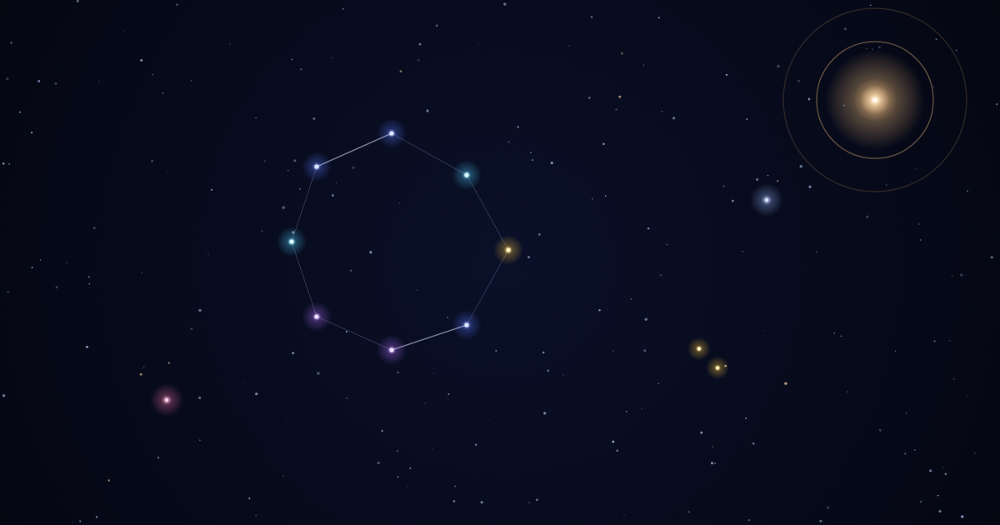

# universe — うちゅう

> 言葉のない宇宙。あなたは一点の光。

**https://uchu.pages.dev**



複数の端末から同じ空を見て、互いの光（カーソル）が見える共有キャンバスです。星を灯し、星どうしを線で結んで星座を作れます。文字や会話の機能は意図的に無く、「同じ空にいる」ことだけを体験にしています。

## 遊び方

| ツール | 操作 | 結果 |
| --- | --- | --- |
| ● 光 | タップ | 波紋を出す |
| ✦ 星 | タップ / なぞる | 星を灯す / 連続で置く |
| ─ 線 | 星から星へドラッグ | 線を引く |
| ⌫ 消 | 星をなぞる | 星を消す |
| 👻 お化け | 幽霊をなぞる | 幽霊を忘れる |

- **ズーム**: ピンチ / ホイール
- **ミニマップ**: 右上の地図をタップでワープ
- **モード切替**: 右下で「みんな」/「ひとり」
- **色選択**: 画面下部の点
- **アンドゥ/リドゥ**: ↶ / ↷ または Ctrl+Z / Ctrl+Y

## 技術スタック

- **フロントエンド**: TypeScript + Canvas 2D（Vite でビルド、ライブラリ依存なし）
- **バックエンド**: TypeScript + Cloudflare Workers + Durable Objects
- **共通**: WebSocket のメッセージ型を [shared/protocol.ts](shared/protocol.ts) でクライアントとサーバーが共有
- **配信**: Cloudflare Pages
- **機能**: リアルタイム同期（WebSocket）、永続化（SQLite）、スパム対策（密度ルール）

## ドキュメント

- [アーキテクチャ](docs/architecture.md): 構成、スケールのための設計、負荷テストの結果
- [拡張ガイド](docs/extending.md): メッセージやツールを足す手順
- [TODO](docs/TODO.md): 未完了のこと・次にやること

## 開発

```bash
npm install
npm run dev:server   # Worker + 静的ファイルをローカルで起動（http://localhost:8787）
npm run typecheck && npm test && npm run build
```
